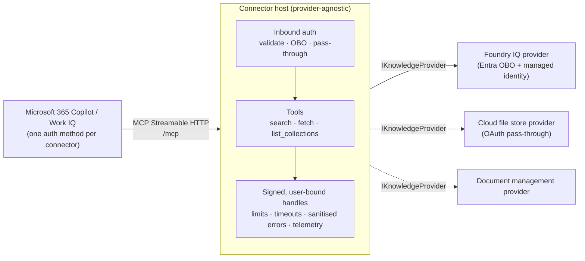

# Federated MCP connector blueprint

[](https://github.com/tolgaki/federated-connector/actions/workflows/ci.yml)
[](LICENSE)

A reusable blueprint for bringing an external data source into **Microsoft 365 Copilot and Work IQ** as a
**federated MCP connector**: a remote, read-only MCP server that Copilot calls live at query time, as the signed-in
user. Nothing is copied into Microsoft 365.

The Copilot-facing side (MCP transport, tools, authentication, result handles, limits, telemetry) is written once in a
shared **host**. The data-source side is a pluggable **provider**. The first provider is
**[Foundry IQ](https://learn.microsoft.com/azure/search/agentic-retrieval-how-to-retrieve) knowledge bases**; others
(document management systems, cloud file stores, line-of-business systems) implement the same small interface.

- C# on .NET 10, ASP.NET Core, [MCP C# SDK](https://github.com/modelcontextprotocol/csharp-sdk) (Streamable HTTP, stateless)
- Three fixed tools: `search`, `fetch`, `list_collections`, all `readOnlyHint: true`
- One authentication method per deployment: Entra SSO + on-behalf-of, OAuth 2.0 pass-through, or none
- A conformance kit any provider runs, including a two-user permission test
- Registration scripts (bash and PowerShell) for both the admin-center and app-package routes

> **Status:** early. Everything here builds and is tested against simulated services; it has **not** been run against
> a live tenant yet. See [Limitations](#limitations) and the design's [open questions](docs/design/blueprint.md#10-open-questions).

The full design is in [docs/design/blueprint.md](docs/design/blueprint.md).

## Contents

- [Architecture](#architecture)
- [Tools](#tools)
- [Repository layout](#repository-layout)
- [Quick start](#quick-start)
- [Configuration](#configuration)
- [Writing a provider](#writing-a-provider)
- [Registration](#registration)
- [Security model](#security-model)
- [Limitations](#limitations)
- [Contributing](#contributing), [Security](#security), [License](#license)

## Architecture



**Rule of thumb:** the host owns everything Copilot sees and everything security-critical. A provider owns only how to
search, read and list one kind of source, using the credentials the host hands it.

Each deployment runs **one** provider, selected by configuration (`Connector:Provider`). Providers are compiled in; two
sources means two deployments of the same image, each registered as its own connector.

## Tools

| Tool | Title | Input | Output |
|---|---|---|---|
| `search` | Search *{DisplayName}* | `query` (required), `collection?`, `top` (1–20, default 8) | `results[]: { id, title, snippet, url, collection, metadata }`, `partial?` |
| `fetch` | Read *{DisplayName}* document | `id` (required) | `{ id, title, url, text, truncated, metadata }` |
| `list_collections` | List *{DisplayName}* *{CollectionNoun}s* | none | `collections[]: { name, description }` |

Every tool is annotated `readOnlyHint: true`, `idempotentHint: true`, `openWorldHint: false`, `destructiveHint: false`.
Results are returned as `structuredContent` and as a JSON text block. Errors are `isError: true` with a fixed category
(`auth`, `forbidden`, `not_found`, `unavailable`, `timeout`, `invalid_request`) and a short, sanitised message.

Result `id`s are signed handles: `v1.<base64url({p, c, d, u, exp})>.<HMAC-SHA256>`. They are bound to the provider and to
the user, expire after an hour by default, and are verified by the host before the provider validates its own payload.

## Repository layout

```
src/
  FederatedConnector.Abstractions/        provider contract (IKnowledgeProvider and models)
  FederatedConnector.Host/                MCP server, auth, handles, limits, telemetry
  FederatedConnector.ContentExtraction/   optional binary → text helper (text, HTML, DOCX)
  Providers/FederatedConnector.Providers.FoundryIq/
tests/
  FederatedConnector.Conformance/         reusable provider conformance kit + in-memory reference provider
  FederatedConnector.Host.Tests/          host unit tests and in-process MCP end-to-end tests
  FederatedConnector.Providers.FoundryIq.Tests/  provider tests over a simulated Search service
tools/
  FederatedConnector.SmokeTest/           initialize · tools/list · search · fetch against a URL
deploy/
  register-connector.sh / .ps1            registration (design §9)
  infra/core.bicep                        Container App, managed identity, Key Vault, App Insights, registry
  providers/foundry-iq/                   provider.json, provision hooks, role assignments
  templates/                              agentConnectors manifest, icons, ATK project templates
docs/design/blueprint.md                  the design
```

## Quick start

Prerequisites: [.NET 10 SDK](https://dotnet.microsoft.com/download/dotnet/10.0).

```bash
dotnet build
dotnet test
```

The test suite needs no cloud access. It includes an in-process end-to-end test that starts the real host composition
on a test server and runs the smoke test against it.

### Run the host locally

The Foundry IQ provider needs a search service, a knowledge base, and an Entra app (see [Registration](#registration)).
With those in place, set the configuration through user secrets or environment variables and run:

```bash
cd src/FederatedConnector.Host
dotnet user-secrets set "AzureAd:TenantId" "<tenant id>"
dotnet user-secrets set "AzureAd:ClientId" "<connector app id>"
dotnet user-secrets set "Providers:FoundryIq:Endpoint" "https://<service>.search.windows.net"
dotnet user-secrets set "Providers:FoundryIq:KnowledgeBases:0:Name" "<knowledge base>"
dotnet run
```

In `Development`, a missing `Connector:HandleSigningKey` falls back to an ephemeral key. Locally, OBO needs a client
credential your machine can use (for example a certificate or a client secret in user secrets) instead of the managed
identity credential configured in `appsettings.json`.

### Smoke test a deployment

```bash
CONNECTOR_TOKEN="<user token for the connector>" \
  dotnet run --project tools/FederatedConnector.SmokeTest -- --url https://<host>/mcp --query "leave policy"
```

It runs `initialize`, `tools/list` (asserting `title` and `readOnlyHint` on every tool), `list_collections`, `search`
and `fetch`, and exits non-zero on any failure.

## Configuration

| Key | Default | Meaning |
|---|---|---|
| `Connector:DisplayName` | `Knowledge` | Name in tool titles and descriptions |
| `Connector:Provider` | — | Compiled-in provider, e.g. `FoundryIq` |
| `Connector:AllowedTenants` | `[]` | Tenant allowlist (EntraObo). Empty: the `AzureAd` tenant's tokens only |
| `Connector:AcceptedAudiences` | `[]` | Token audiences: `api://<appId>`, the app id, and the Developer Portal `api://auth-…` URI |
| `Connector:RequiredScope` | `access_as_user` | Delegated scope Copilot must present |
| `Connector:HandleSigningKey` | — | Base64 HMAC key (≥ 32 bytes), from Key Vault. Required outside Development |
| `Connector:PreviousHandleSigningKey` | — | Accepted for verification only, for key rotation |
| `Connector:HandleLifetimeMinutes` | `60` | Handle expiry |
| `Connector:ManagedIdentityClientId` | — | User-assigned managed identity for service credentials |
| `Connector:KeyVaultUri` | — | Key Vault for provider secrets |
| `Connector:Limits:ToolTimeoutSeconds` | `8` | Overall per-tool timeout |
| `Connector:Limits:MaxFetchChars` | `20000` | Fetch text cap |
| `Connector:Limits:MaxSnippetChars` | `500` | Search snippet cap |
| `Connector:Limits:RequestsPerMinutePerUser` | `60` | Per-user rate limit |
| `AzureAd:*` | — | Microsoft.Identity.Web settings (EntraObo). OBO uses a managed-identity federated credential |
| `Providers:<Name>:*` | — | The provider's own section |

Foundry IQ (`Providers:FoundryIq`): `Endpoint`, `KnowledgeBases[] { Name, Description?, KnowledgeSources[]? }`,
`UsePreviewApi` (citationUrl and sensitivity labels), `ApiVersion`, `PreviewApiVersion`, `OutputMode`,
`ExcludedKnowledgeSourceKinds` (default `workIQ`), optional `KnowledgeSources[] { Name, Kind, Index, KeyField }`
overrides that skip discovery, field-name lists (`TitleFields`, `ContentFields`, `UrlFields`, …), and
`VerifyCitationUrlTrimming` (default `true`). See
[FoundryIqOptions.cs](src/Providers/FederatedConnector.Providers.FoundryIq/FoundryIqOptions.cs).

Telemetry goes to Application Insights when `APPLICATIONINSIGHTS_CONNECTION_STRING` is set. It records tool, provider,
collection, outcome, latency, result count, source status and hashed tenant and user ids; **never** query text or
document content.

## Writing a provider

1. **Create a project** that references `FederatedConnector.Abstractions` (it can live in its own repository).
2. **Implement `IKnowledgeProvider`:**

   ```csharp
   public sealed class MyProvider : IKnowledgeProvider
   {
       public ProviderDescriptor Descriptor { get; } = new(
           Id: "my-source",                                   // lowercase, goes into handles
           ContentDescription: "engineering design documents", // goes into tool descriptions
           Auth: new AuthRequirement.OAuthPassthrough(
               new Uri("https://idp.example.com/authorize"), new Uri("https://idp.example.com/token"),
               ["read"], SupportsPkce: true),
           CollectionNoun: "workspace");

       public Task<IReadOnlyList<CollectionInfo>> ListCollectionsAsync(ProviderContext ctx, CancellationToken ct) => …;

       public async Task<SearchResultSet> SearchAsync(SearchQuery q, ProviderContext ctx, CancellationToken ct)
       {
           var token = await ctx.UserToken.GetTokenAsync(null, ct);   // always query as the user
           …
           return new SearchResultSet(hits);                          // each hit carries a small HandlePayload
       }

       public async Task<DocumentContent> FetchAsync(HandlePayload h, ProviderContext ctx, CancellationToken ct)
       {
           // Validate h against your configured source first; never follow a payload URL blindly.
           // Re-read the document as the user; don't replay search-time content.
           …
       }

       public static ProviderRegistration Registration { get; } = new(
           "MySource",
           section => /* descriptor from config */ …,
           (services, section) => services.AddSingleton<IKnowledgeProvider, MyProvider>());
   }
   ```

3. **Honour the obligations** (design §3.1): read only; query as the user; re-check access on fetch; validate handle
   payloads; keep payloads small and secret-free; honour cancellation (return `Partial = true` rather than hang).
   Throw `ProviderException` with a `ProviderErrorKind` for expected failures; never put response bodies in it.
4. **Run the conformance kit.** In your test project, implement `IConformanceFixture` (two users, a query that only
   user A can satisfy, foreign payloads, a write check) and derive one class:

   ```csharp
   public sealed class MyProviderConformance(MyFixture f) : ProviderConformanceTests<MyFixture>(f);
   ```

   [`InMemoryConformanceFixture`](tests/FederatedConnector.Conformance/InMemoryConformanceFixture.cs) and
   [`FoundryIqConformanceFixture`](tests/FederatedConnector.Providers.FoundryIq.Tests/FoundryIqConformance.cs) are
   worked examples; the latter simulates the source over a fake `HttpMessageHandler`.
5. **Compile it in:** add `MyProvider.Registration` to the list in
   [Program.cs](src/FederatedConnector.Host/Program.cs) and set `Connector:Provider = "MySource"`.
6. **Add deployment metadata:** `deploy/providers/<id>/provider.json` (auth mode, inputs, settings mapping, ATK OAuth
   settings) and optional `provision.sh` / `provision.ps1` / `infra.bicep` hooks.

## Registration

The registration scripts implement design §9. They are idempotent (state in `deploy/.env.<env>`, which is git-ignored)
and `--destroy` / `-Destroy` reverses them.

```bash
./deploy/register-connector.sh --env dev --provider foundry-iq --display-name "Contoso Knowledge" --route package \
  --publisher-name "Contoso" --publisher-url https://contoso.example \
  --privacy-url https://contoso.example/privacy --terms-url https://contoso.example/terms \
  --search-service contoso-search --search-resource-group rg-search --knowledge-bases "hr-kb,eng-kb"
```

```powershell
./deploy/register-connector.ps1 -EnvName dev -Provider foundry-iq -DisplayName "Contoso Knowledge" -Route package `
  -PublisherName Contoso -PublisherUrl https://contoso.example `
  -PrivacyUrl https://contoso.example/privacy -TermsUrl https://contoso.example/terms `
  -Inputs @{ 'search-service' = 'contoso-search'; 'search-resource-group' = 'rg-search'; 'knowledge-bases' = 'hr-kb,eng-kb' }
```

| Step | What happens |
|---|---|
| 0. Preflight | Checks `az`, `atk`, `jq` and logins; collects the provider's inputs |
| 1. Core infrastructure | Deploys `core.bicep`; generates the handle-signing key straight into Key Vault (the vault name is salted per run, so re-creating after `--destroy` doesn't collide with the soft-deleted vault) |
| 2. Provider provisioning | Runs the provider hook (Foundry IQ: role assignments on the search service) |
| 3a. Entra SSO + OBO | Creates the Entra app (`access_as_user`, downstream permission, admin consent, managed-identity federated credential, Teams redirect URI) and registers SSO with ATK `oauth/register` |
| 3b. OAuth pass-through | Registers the source's OAuth client with ATK `oauth/register` (`identityProvider: Custom`) |
| 4. Deploy | Builds the image in the registry and deploys it together with every setting in one deployment |
| 5. Smoke test | Health check; full MCP smoke test when `CONNECTOR_TOKEN` is set |
| 6A. Admin route | Prints the base URL and registration id for *Copilot → Connectors → Connect to MCP server* (manual) |
| 6B. Package route | Renders the `agentConnectors` manifest, validates it, and sideloads (`atk provision`) or publishes (`--publish`) |

Requirements: Azure CLI (logged in), [Microsoft 365 Agents Toolkit CLI](https://learn.microsoft.com/microsoftteams/platform/toolkit/microsoft-365-agents-toolkit-cli)
(`atk`), `jq` (bash script), and permission to create Entra apps and grant admin consent.

Registration asks for a privacy statement and terms of use. [PRIVACY.md](PRIVACY.md) and [TERMS.md](TERMS.md) are
**templates** for the deployer to complete and publish; they are not legal text for this project.

## Security model

- **Fail closed.** If the provider needs a user credential and none is available, the host fails the call before the
  provider runs. Providers also refuse user-scoped calls without a user token.
- **Query as the user.** Foundry IQ calls carry the managed-identity token in `Authorization` and the user's OBO token
  in `x-ms-query-source-authorization`, so Search trims results to what the user may see. Knowledge bases are assumed to
  be indexed with permissions already; the connector does not index.
- **Re-check on fetch.** Fetch re-reads as the user. On the GA API it is a key-filtered search under the user's token;
  on the preview API it follows `citationUrl` after the same access check (until citation trimming is verified).
- **Handles** are HMAC-signed, user-bound, provider-bound and short-lived; payloads are validated against the
  configured endpoint, knowledge-base allowlist and index before use.
- **Errors** are sanitised to fixed categories; source response bodies are never forwarded or logged.
- **No client secrets** for Entra: OBO uses a managed-identity federated credential. The handle key lives in Key Vault.
- **Work IQ knowledge sources are excluded** by default so results don't loop back into Copilot.

## Limitations

Implementation choices and deviations from the design:

- **Untested against live services.** Search, Entra, Developer Portal, ATK and the admin center are simulated or
  stubbed in tests. The ATK `oauth/register` fields, the `agentConnectors` manifest shape and the Foundry IQ API
  versions (`2026-04-01`, `2026-08-01-preview`) follow the documentation cited in the design and need confirming
  against a live tenant.
- **GA fetch** uses a key-filtered search as the user instead of `GET /indexes/{index}/docs/{key}`, because document
  lookup trimming is unverified; the search is both the read and the access check.
- **Definition reads.** Discovering knowledge base, knowledge source and index definitions needs more than
  *Search Index Data Reader*. The Foundry IQ hook also grants the read-only *Reader* role on the search service by
  default (`--definition-read-role`: `Reader`, `SearchServiceContributor` or `None`). Whether *Reader* is sufficient
  for knowledge base definitions needs confirming on a live service. With `None`, configure
  `Providers:FoundryIq:KnowledgeBases[].KnowledgeSources` and `Providers:FoundryIq:KnowledgeSources[]` (with
  `Index` and `KeyField`) explicitly; descriptions are then optional. The connector never writes.
- **Remote knowledge sources** (web, remote SharePoint) cannot be re-read by key; `fetch` returns the search-time
  excerpt with `truncated: true`. This follows design §6.2, but for a non-public remote source it means `fetch` does
  not re-check access (a tension with §3.1 item 3). The excerpt only goes back to the same user, within the handle
  lifetime.
- **Work IQ exclusion** leaves Work IQ sources out of `knowledgeSourceParams` and drops any Work IQ references. Whether
  the retrieve API still queries sources that the request omits needs confirming on a live service; if it does,
  remove Work IQ sources from knowledge bases that the connector serves.
- **GA fetch** filters on the index key field, which must be filterable.
- **Auth errors from the source** surface as an `isError` result with category `auth`, not as an HTTP 401, because the
  stateless Streamable HTTP response is already under way.
- **`invalid_request`** is an extra error category for host-side argument validation.
- **No output schemas** are declared on the tools yet; **filters** are a v2 extension; **PDF** extraction is not
  included in `ContentExtraction`.
- The OAuth pass-through path and binary extraction have not been exercised by a real second provider (build step 5).

## Contributing

See [CONTRIBUTING.md](CONTRIBUTING.md) and the [Code of Conduct](CODE_OF_CONDUCT.md). Changes are tracked in
[CHANGELOG.md](CHANGELOG.md).

## Security

Please report vulnerabilities privately; see [SECURITY.md](SECURITY.md).

## License

[MIT](LICENSE) © 2026 Tolga Kilicli
